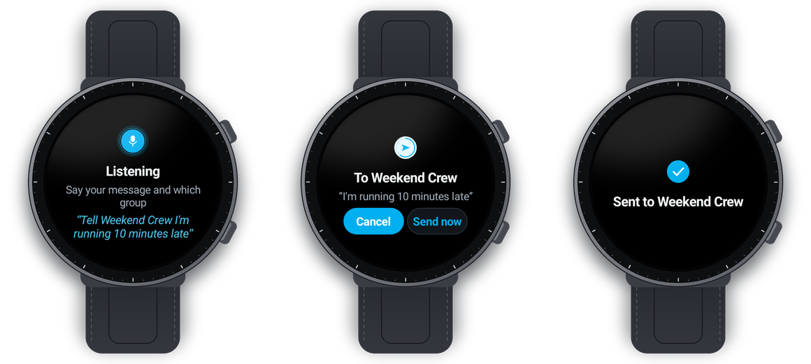
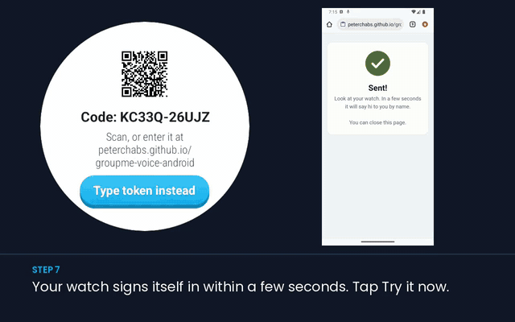
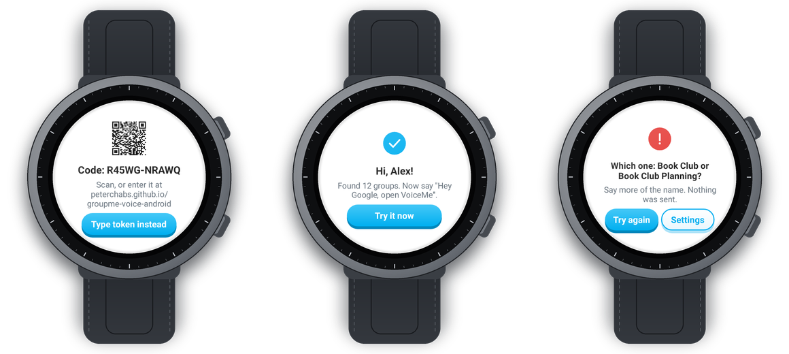

# VoiceMe

> **Not affiliated with GroupMe or Microsoft.** This is an independent, free, open-source project. GroupMe is a trademark of Microsoft.

Send a GroupMe message just by talking to your **Galaxy Watch** (or any Wear OS watch).

You say: **"Hey Google, open VoiceMe"**
It listens, and your words appear on screen as you talk:
**"Tell Weekend Crew I'm running 10 minutes late"**
It shows who it's sending to, counts down 3 seconds (so you can cancel), then sends.

<p align="center">
  
</p>
<p align="center"><sub>Listening, then 3 seconds to cancel, then sent. These are the real app screens.</sub></p>

The message goes out from **your own GroupMe account**, to **your own groups**,
with **whatever words you say each time**. You don't need to know how to code.

<p align="center">
  <a href="https://peterchabs.github.io/groupme-voice-android/video.html"></a>
</p>
<p align="center"><b><a href="https://peterchabs.github.io/groupme-voice-android/video.html">Watch the full 3-minute setup and features video</a></b></p>

## What it takes

VoiceMe lives on your watch. A small free app on your **Android phone** signs it in
to GroupMe once, with GroupMe's own sign-in. After that the watch works on its own.

---

## Galaxy Watch app

A small app that lives on your watch and talks to GroupMe by itself.

### What you need

- A **Galaxy Watch 4 or newer** (or any watch with Wear OS 3 or newer).
- **An Android phone** for the free [VoiceMe phone app](#say-so-phone-app-android), which signs
  your watch in to GroupMe. (iPhones can't be used to sign in.)
- Your GroupMe account. Sign in the way you always do: Google, Microsoft, Apple,
  email or phone number.
- **A computer** (Windows or Mac) on the same Wi-Fi as your watch, only to put
  the app on your watch the first time.

Setup, once: put VoiceMe on your watch, install the phone app, then scan the
watch's QR code with your phone. After that it's just "Hey Google".

---

### Step 1: Put VoiceMe on your watch (one time)

VoiceMe isn't in the Play Store, so it goes on your watch from a computer. It
takes about 5 minutes and you never do it again.

<details>
<summary><b>Show the install steps</b></summary>

#### A. Download the files to your computer

You need two downloads. Both are free.

**The watch app**

1. On your computer, open this link:
   **https://github.com/peterchabs/groupme-voice-android/releases/latest**
2. Scroll down to the **Assets** section.
3. Click **VoiceMe-watch.apk**. It saves to your **Downloads** folder.

> Don't use the green **Code** button or **Download ZIP** on the main page.
> That's the source code, not the app. You only need the one file above.

**Google's free install tool ("Platform Tools")**

1. Download the ZIP for your computer:
   - **Windows:** https://dl.google.com/android/repository/platform-tools-latest-windows.zip
   - **Mac:** https://dl.google.com/android/repository/platform-tools-latest-darwin.zip
2. Open your **Downloads** folder and unzip it:
   - **Windows:** right-click the ZIP, click **Extract All**, then **Extract**.
   - **Mac:** double-click the ZIP.
3. You now have a folder called **platform-tools**.
4. **Move the watch app into that folder:** drag **VoiceMe-watch.apk**
   into the **platform-tools** folder.


#### B. Turn on "install apps" mode on your watch

1. On your watch, open **Settings**.
2. Scroll down and tap **About watch**, then **Software information**.
3. Tap **Software version** about 7 times, until a message says developer mode is on.
4. Go back to the main **Settings** screen. Scroll to the bottom and tap the
   new **Developer options**.
5. Turn on **ADB debugging**. Tap **OK** if asked.
6. Make sure your watch is on Wi-Fi: **Settings** > **Connections** > **Wi-Fi**,
   and pick the **same Wi-Fi network** your computer is on.
7. Back in **Developer options**, tap **Wireless debugging** and turn it on.
   Tap **Allow** if asked.

Keep your watch screen on the **Wireless debugging** page. You'll need it next.


#### C. Open a command window inside the platform-tools folder

**Windows**

1. Open the **platform-tools** folder.
2. Click once in the **address bar** at the top of the window (where it shows the folder path).
3. Type `cmd` and press **Enter**. A black window opens. That's the command window.

**Mac**

1. Open **Terminal** (press **Command + Space**, type `Terminal`, press **Enter**).
2. Type `cd ` (the letters c, d, and a space). Don't press Enter yet.
3. Drag the **platform-tools** folder into the Terminal window, then press **Enter**.

> **Mac users:** in the commands below, type `./adb` instead of `adb`.


#### D. Install the app on your watch

**1. Pair your computer with your watch**

1. On your watch, on the **Wireless debugging** page, tap **Pair new device**.
   It shows a **6-digit code** and an address like `192.168.1.23:41235`.
2. In the command window, type `adb pair ` followed by **that address**, then press **Enter**. Example:

   ```
   adb pair 192.168.1.23:41235
   ```

3. When it asks for the pairing code, type the **6-digit code** from your watch and press **Enter**.
4. You should see **"Successfully paired"**.

**2. Connect**

1. On your watch, go back one screen to the main **Wireless debugging** page.
   Under **IP address & port** it shows another address (the last number is different
   from the pairing one).
2. Type `adb connect ` followed by **that address**, then press **Enter**. Example:

   ```
   adb connect 192.168.1.23:38741
   ```

3. You should see **"connected to ..."**. If your watch asks **Allow debugging?**, tap **Allow**.

**3. Install**

1. Type this and press **Enter**:

   ```
   adb install VoiceMe-watch.apk
   ```

2. Wait until it says **Success**. The app is now on your watch.

**4. Turn install mode back off (recommended)**

On your watch, go to **Settings** > **Developer options** and turn off
**Wireless debugging** and **ADB debugging**. The app stays installed.

</details>

---

### Step 2: Scan the QR code to sign in


<p align="center">
  
</p>

1. On your watch, open your apps list and tap **VoiceMe**.
2. The watch shows a **QR code** and a **10-character code** like `K7Q2M-9XAPZ`.
3. On your Android phone, open the **camera** and point it at the QR code on your
   watch. Tap the link that pops up.
   - Camera won't scan it? On your phone, go to
     **peterchabs.github.io/groupme-voice-android** and type the code from your watch.
4. On the page:
   1. Don't have the VoiceMe phone app yet? Tap **Download for Android** and install
      it (see [the phone app](#say-so-phone-app-android) for the steps).
   2. Tap **Open VoiceMe**. The phone app opens with your watch's code.
   3. Tap **Sign in with GroupMe** and sign in the way you always do. GroupMe's own
      sign-in opens inside the app.
   4. Tap **Send to watch**.
   - Or open the phone app yourself, tap **Sign in a watch**, and type the code
     from your watch.
   - Your sign-in is locked with the code from your watch before it leaves your
     phone, and only your watch can unlock it.
5. Within a few seconds your watch says **"Hi, [your name]!"** and how many groups it found.

That's it. You're set up.

---

### Step 3: Use it

1. Say **"Hey Google, open VoiceMe"** to your watch.
   (Or just tap the app.) It starts listening as soon as it opens, so you can
   pause for a second and keep talking. "Hey Google" only opens the app; it
   can't take your message in the same breath.
2. The first time only, it asks to use the microphone. Tap **Allow**.
3. When the circle starts pulsing, say your message and name the group anywhere in it,
   the way you'd say it to a person:

   - **"Tell Family I'm picking up pizza"**
   - **"I'm picking up pizza, tell Family"**
   - **"Let Family know I'm picking up pizza"**
   - **"Family, I'm picking up pizza"**

   The screen switches to **To Family** as soon as it hears the name, so you know
   where it's going before you finish. Say just **"Family"** and it asks
   **What's the message?** while it keeps listening. "That says" still works too.
4. Your words appear as you speak. Then it shows the group and your message,
   and a ring counts down **3 seconds**.
   - Heard you wrong? Tap **Cancel**. Nothing is sent.
   - In a hurry? Tap **Send now**.
5. A green check and a buzz mean it's **sent**.

**If "Hey Google, open VoiceMe" searches the web instead:** Google can be slow to
find apps that weren't installed from the Play Store. Set a button to open it
instead, which works every time: on the watch, open **Settings > Advanced
features > Customize keys**, choose **Double press**, and pick **VoiceMe**. Now
double-press the side button and start talking.

**What the screen shows:**

| You see | It means |
|---|---|
| Blue circle with rings that grow when you talk | Listening |
| Spinning ring | Working on it |
| Ring that shrinks to nothing | Sending in a moment (tap Cancel to stop) |
| Green circle with a check | Sent |
| Red circle that shakes | Something's wrong. The words under it say what, and nothing was sent |

### Everything else the watch app does

**[Watch the 3-minute video](https://peterchabs.github.io/groupme-voice-android/video.html)**
of setup and every feature, recorded on a real watch screen with captions.

- **Chats:** tap **Chats** to see every group and direct message, newest first. A
  red count on a chat's picture says how many new messages it has. Read counts stay in
  sync with GroupMe's own apps: read a chat on your phone and the count clears on your
  watch, and the other way around. Open one and it picks
  up where you left off, with a "New messages" line above what's new. Photos, videos, links and
  events show right in the chat.
- **Talk in a chat:** tap the mic in any chat and talk. Your words type into a blue
  bubble at the bottom of the chat as you speak, and the messages above slide up to
  make room. Then it sends.
- **Live chat:** see when someone is typing ("Sam is typing..."), and they see you
  writing while you talk. In a direct message, "Read 5:34 PM" shows when they've read
  what you sent.
- **Reply to a message:** hold any message. It glows and VoiceMe listens; what you
  say goes out as a GroupMe reply to that message, with a small quote of it.
- **React:** double-tap any message for a row of emoji. Tap one to react, or tap
  yours again to take it off. Reactions show as small badges under each message.
- **Members:** swipe left from a group chat. People are grouped by rank: the owner,
  admins, then everyone else. Tap someone for their profile: their role, their GroupMe
  name if they go by another one in the group, when they last posted, and their photos
  from the group (on a phone, also the groups you share). Message or tag them from there.
- **Tag people:** on the members page, hold someone, tap more people, then tap
  **Tag and speak**. Their pictures line up under the chat name while you talk, and
  GroupMe notifies everyone you tagged.
- **Photos and videos:** swipe left again for the group's gallery. Each one shows
  who posted it. Tap a photo to see it full screen, then double-tap or pinch to zoom
  and drag to look around.
  Videos play right on the watch.
- **Events:** swipe left once more for the group's upcoming events, with each one's
  photo and who made it. Tap an event in the chat to see when, where, and who's going.
- **Notifications:** new messages pop up on your watch with who sent them. Reply
  right there, or say **"Hey Google, respond to that message"** to answer with Gemini.
  Either way it goes out as a reply to that message. You can turn the notification
  sound off and keep just the buzz.
- **Settings:** pull down from the top of any page. Pick a **default group** (then
  "Hey Google, open VoiceMe" opens that chat, already listening), turn photos and
  notifications on or off, switch between **light and dark**, and see how to set a
  watch button to open VoiceMe.

### More things you can say

<p align="center">
  
</p>

| Say | What happens |
|---|---|
| **"Tell Weekend Crew running late"** or **"Running late, tell Weekend Crew"** | Sends to that group (name it first, last, or in the middle) |
| **"Reply saying I've got 4"** | Replies to the newest message someone sent you (group or direct), quoting it |
| **"Like that"** or **"Heart that message"** | Hearts the newest message someone sent you |
| **"DM Jordan saying call me"** | Sends Jordan a private message |
| **"Jordan that says call me"** | Same thing, if you don't have a group called Jordan |
| **"picking up pizza"** (just the message) | Goes to your default group, if you set one (below) |

Every one of these shows the 3-second countdown first, with who it's going to
or what you're replying to, so you can tap **Cancel** if it's wrong.

"The newest message" means the newest one from someone else, so if a GroupMe
notification just came in, "reply saying..." answers that one.

### Optional: set a default group

If you mostly message the same group, set it as your default. Then you can skip
the group name and just say your message.

<p align="center">
  
</p>

1. In the app, tap **Settings**.
2. Tap **Default group** (on the watch, **Default**) and pick the group.
3. Tap **Talk now** and just say your message, like **"picking up pizza on the way home"**. It goes to your default group.

From Settings you can always get back to talking with **Talk**, or by going back
(swipe right on the watch).

You can still send to any other group by naming it:
**"Running late, tell Weekend Crew"**. The 3-second countdown always shows
which group it's going to, so you can tap **Cancel** if it's wrong.

If you say a group name it can't find, it **sends nothing**. It never falls back
to your default group, so a misheard name can't send to the wrong place.

To turn it off, go to **Settings** > **Default group** (watch: **Default**) > **No default**.

**Tips**

- You only need part of the group name. "Crew" finds "Weekend Crew".
  If two groups match, it asks which one and **sends nothing**. It never guesses.
- **"Hey Google" doesn't work?** Many Galaxy Watches come set to Bixby.
  Try **"Hi Bixby, open VoiceMe"**, or install **Google Assistant** (or
  **Gemini**) from the Play Store on your watch and make it your assistant.
- **Want a button for it?** On many Galaxy Watches: **Settings** > **Advanced features** >
  **Customize buttons** > **Double press** > pick **VoiceMe**.
- Your watch needs internet, either through your phone (Bluetooth), Wi-Fi, or LTE.
- To switch accounts or sign out, tap **Settings** in the app. Swipe right to go back.

---

### Watch: something not working?

| What happens | What to do |
|---|---|
| **"adb is not recognized"** or **"command not found"** | Your command window isn't in the platform-tools folder. Redo part C of Step 1. On a Mac, type `./adb`, not `adb`. |
| **"failed to connect"** or pairing fails | Check the watch and computer are on the same Wi-Fi. The addresses change each time you turn on Wireless debugging, so read them off the watch again. |
| **"No such file"** when installing | The app file isn't in the platform-tools folder. Drag **VoiceMe-watch.apk** in there (Step 1, part A). |
| The watch says **"That code expired"** | Codes last 10 minutes. Tap **Get a new code** and scan again. |
| **Open VoiceMe** on the page downloads the app instead | The phone app isn't installed yet. Install it, then tap **Open VoiceMe** again. |
| **"GroupMe signed you out"** | Your sign-in stopped working (it expired, or you signed out of GroupMe everywhere). Tap **Sign in again** and do Step 2 again. If you were sending something, tap **Send it now** after signing in. |
| The watch says **"VoiceMe now uses GroupMe's own sign-in"** | Your watch was signed in the older way, which GroupMe no longer lets send direct messages, so VoiceMe signed it out. Do Step 2 once with the phone app. Your default group and settings are kept. |
| It can't find your group | Say more of the group's name, a little slower. |
| **"I didn't catch that"** | Tap **Try again** and speak a little closer, or tap **Type it** and type what you'd say (for example **Tell Family hi**). Typing works exactly like talking. |

---

## VoiceMe phone app (Android)

A small app for your phone that signs your watch in to GroupMe. That's all it does:
it has no chats and doesn't run in the background.

**Works on:** Android 8 or newer.

### Step 1: Download it on your phone

1. On your phone, open this link:
   **https://github.com/peterchabs/groupme-voice-android/releases/latest**
2. Scroll down to **Assets** and tap **VoiceMe-phone.apk**.
3. If your browser warns that the file might be harmful, tap **Download anyway**.
   (It warns about every app that doesn't come from the Play Store.)

### Step 2: Install it

1. When the download finishes, tap **Open**. (Or open your **Files** app, go to
   **Downloads**, and tap **VoiceMe-phone.apk**.)
2. If your phone says it isn't allowed to install apps from this source, tap
   **Settings**, turn on **Allow from this source**, then tap the back arrow.
3. Tap **Install**.
4. If **Google Play Protect** says it doesn't recognize the app, tap
   **More details**, then **Install anyway**. It only says this because the app
   isn't from the Play Store.
5. Tap **Open**.

### Step 3: Sign in to GroupMe

1. Tap **Sign in with GroupMe**. GroupMe's own sign-in opens inside the app.
2. Sign in the way you always do: Google, Microsoft, Apple, or your email or phone
   number and password. (If GroupMe texts you a code, enter that too.)
3. The app says **"Signed in as [your name]"**.

Your password goes only to GroupMe (or to Google, Microsoft or Apple if you use
them). The app clears GroupMe's page from its memory right after.

### Step 4: Sign in your watch

Scan the QR code on your watch with your phone's camera and tap **Open VoiceMe** on
the page, or tap **Sign in a watch** in the app and type the code. Then tap
**Send to watch**. You can sign in more than one watch this way.

To use a different GroupMe account, tap **Sign out** and sign in again.

---

## Is this safe? Where does my information go?

**There is no server of ours.** Nobody running this project ever sees your
GroupMe sign-in, your groups, or your messages.

- **Your messages** go straight from your watch to GroupMe, and nowhere else.
- **Your voice** is turned into text by your watch's built-in speech
  service (Google's, the same one used when you dictate a text). Only the text
  is sent, and only to GroupMe.
- **Your sign-in** is stored only inside the app on your device. Signing out
  deletes it.
- **When you sign in**, you log in on GroupMe's own sign-in page inside the phone
  app. Your password goes only to GroupMe (or to Google, Microsoft or Apple if you
  use them), and the sign-in goes straight into the app. Nothing passes through
  GitHub. When the phone app signs in a watch, it locks the sign-in with the
  watch's code first.
- **Sign-in to a watch** travels through a free relay ([ntfy.sh](https://ntfy.sh))
  in locked form. The relay can't unlock it; only your watch has the key, and the
  code expires after 10 minutes.
- All the code is here if you want to look: [`watch-app/`](watch-app/) (phone and
  watch apps) and [`docs/index.html`](docs/index.html) (sign-in page).

## Not affiliated with GroupMe or Microsoft

VoiceMe is an independent project. It is not made, endorsed, or supported by
GroupMe or Microsoft. GroupMe is a trademark of Microsoft Corporation, and the name
is used here only to say which service the app works with. For help with your
GroupMe account itself, contact GroupMe.
