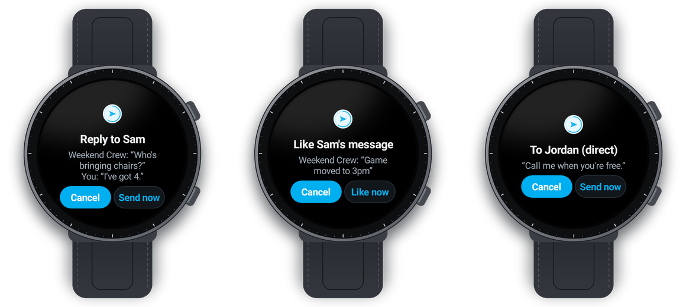
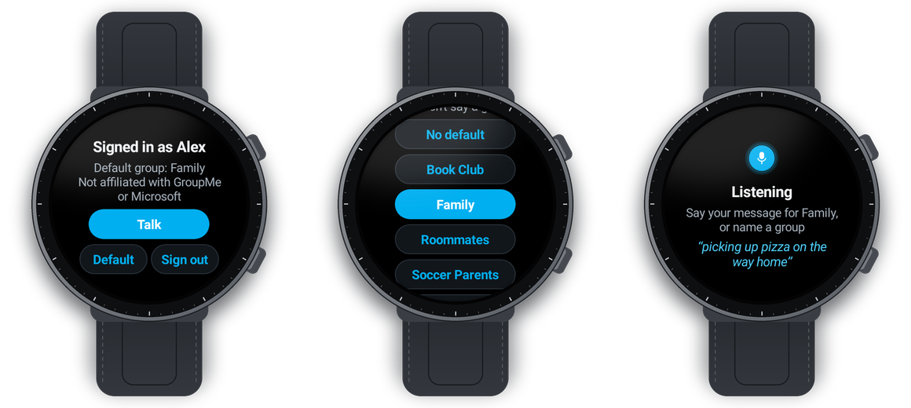
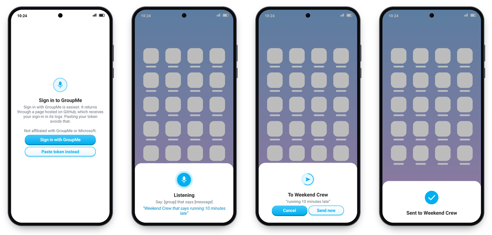

# Say So

> **Not affiliated with GroupMe or Microsoft.** This is an independent, free, open-source project. GroupMe is a trademark of Microsoft.

Send a GroupMe message just by talking to your **Galaxy Watch** or **Android phone**.

You say: **"Hey Google, open Say So"**
It listens, and your words appear on screen as you talk:
**"Weekend Crew that says I'm running 10 minutes late"**
It shows who it's sending to, counts down 3 seconds (so you can cancel), then sends.

<p align="center">
  
</p>
<p align="center"><sub>Listening, then 3 seconds to cancel, then sent. These are the real app screens.</sub></p>

The message goes out from **your own GroupMe account**, to **your own groups**,
with **whatever words you say each time**. You don't need to know how to code.

## Pick one

| I want to talk to... | Use | Cost | Time |
|---|---|---|---|
| **My Galaxy Watch** | [The watch app](#galaxy-watch-app) | Free | about 20 minutes, once |
| **My Android phone** | [The phone app](#android-phone-app) | Free | about 5 minutes, once |

You can set up both. They don't need each other.

---

## Galaxy Watch app

A small app that lives on your watch and talks to GroupMe by itself.

### What you need

- A **Galaxy Watch 4 or newer** (or any watch with Wear OS 3 or newer).
- **A computer** (Windows or Mac), only for installing the app one time.
- Your computer and your watch on the **same Wi-Fi**.
- **A phone** (any kind, even an iPhone) to sign in to GroupMe.
- Your GroupMe email or phone number and password.

You only do Steps 1 to 5 once. After that it's just "Hey Google".

---

### Step 1: Download the files to your computer

You need two downloads. Both are free.

**A. The watch app**

1. On your computer, open this link:
   **https://github.com/peterchabs/groupme-voice-android/releases/latest**
2. Scroll down to the **Assets** section.
3. Click **SaySo-watch.apk**. It saves to your **Downloads** folder.

> Don't use the green **Code** button or **Download ZIP** on the main page.
> That's the source code, not the app. You only need the one file above.

**B. Google's free install tool ("Platform Tools")**

1. Download the ZIP for your computer:
   - **Windows:** https://dl.google.com/android/repository/platform-tools-latest-windows.zip
   - **Mac:** https://dl.google.com/android/repository/platform-tools-latest-darwin.zip
2. Open your **Downloads** folder and unzip it:
   - **Windows:** right-click the ZIP, click **Extract All**, then **Extract**.
   - **Mac:** double-click the ZIP.
3. You now have a folder called **platform-tools**.
4. **Move the watch app into that folder:** drag **SaySo-watch.apk**
   into the **platform-tools** folder.

---

### Step 2: Turn on "install apps" mode on your watch

1. On your watch, open **Settings**.
2. Scroll down and tap **About watch**, then **Software information**.
3. Tap **Software version** about 7 times, until a message says developer mode is on.
4. Go back to the main **Settings** screen. Scroll to the bottom and tap the
   new **Developer options**.
5. Turn on **ADB debugging**. Tap **OK** if asked.
6. Make sure your watch is on Wi-Fi: **Settings** > **Connections** > **Wi-Fi**,
   and pick the **same Wi-Fi network** your computer is on.
7. Back in **Developer options**, tap **Wireless debugging** and turn it on.
   Tap **Allow** if asked.

Keep your watch screen on the **Wireless debugging** page. You'll need it next.

---

### Step 3: Open a command window inside the platform-tools folder

**Windows**

1. Open the **platform-tools** folder.
2. Click once in the **address bar** at the top of the window (where it shows the folder path).
3. Type `cmd` and press **Enter**. A black window opens. That's the command window.

**Mac**

1. Open **Terminal** (press **Command + Space**, type `Terminal`, press **Enter**).
2. Type `cd ` (the letters c, d, and a space). Don't press Enter yet.
3. Drag the **platform-tools** folder into the Terminal window, then press **Enter**.

> **Mac users:** in the commands below, type `./adb` instead of `adb`.

---

### Step 4: Install the app on your watch

**4a. Pair your computer with your watch**

1. On your watch, on the **Wireless debugging** page, tap **Pair new device**.
   It shows a **6-digit code** and an address like `192.168.1.23:41235`.
2. In the command window, type `adb pair ` followed by **that address**, then press **Enter**. Example:

   ```
   adb pair 192.168.1.23:41235
   ```

3. When it asks for the pairing code, type the **6-digit code** from your watch and press **Enter**.
4. You should see **"Successfully paired"**.

**4b. Connect**

1. On your watch, go back one screen to the main **Wireless debugging** page.
   Under **IP address & port** it shows another address (the last number is different
   from the pairing one).
2. Type `adb connect ` followed by **that address**, then press **Enter**. Example:

   ```
   adb connect 192.168.1.23:38741
   ```

3. You should see **"connected to ..."**. If your watch asks **Allow debugging?**, tap **Allow**.

**4c. Install**

1. Type this and press **Enter**:

   ```
   adb install SaySo-watch.apk
   ```

2. Wait until it says **Success**. The app is now on your watch.

**4d. Turn install mode back off (recommended)**

On your watch, go to **Settings** > **Developer options** and turn off
**Wireless debugging** and **ADB debugging**. The app stays installed.

---

### Step 5: Sign in to GroupMe

<p align="center">
  
</p>

1. On your watch, open your apps list and tap **Say So** (the blue microphone).
2. The watch shows a **QR code** and a **10-character code** like `K7Q2M-9XAPZ`.
3. On your phone, open the **camera** and point it at the QR code on your watch.
   Tap the link that pops up.
   - Camera won't scan it? On your phone, go to
     **peterchabs.github.io/groupme-voice-android** and type the code from your watch.
4. On the page, pick one way:
   - **Use the Say So phone app** (easiest, needs the
     [phone app](#android-phone-app) on your phone): the app opens and you log in on
     GroupMe's own site inside it, with your normal email or phone number and
     password. The app sends your sign-in to the watch by itself. If the phone app is
     already signed in, just tap **Send to watch**. (No QR code handy? In the phone
     app, tap **Settings**, then **Sign in a watch**, and type the code.)
   - **Paste your token** (no phone app needed): follow the steps on the page to
     copy your token from dev.groupme.com, then paste it and tap **Send to my watch**.
   - **Sign in with GroupMe**: GroupMe's older sign-in page. It rejects some
     accounts with **"invalid credentials"** even when the login is right, and it
     returns through the GitHub-hosted page, so GitHub receives your sign-in in its
     normal logs.
   - Any way you pick, your sign-in is locked with the code from your watch before
     it's sent, and only your watch can unlock it.
5. Within a few seconds your watch says **"Hi, [your name]!"** and how many groups it found.

That's it. You're set up.

---

### Step 6: Use it

1. Say **"Hey Google, open Say So"** to your watch.
   (Or just tap the app.) It starts listening as soon as it opens, so you can
   pause for a second and keep talking. "Hey Google" only opens the app; it
   can't take your message in the same breath.
2. The first time only, it asks to use the microphone. Tap **Allow**.
3. When the circle starts pulsing, say:

   > **[group name]** that says **[your message]**

   For example: **"Family that says I'm picking up pizza"**.
4. Your words appear as you speak. Then it shows the group and your message,
   and a ring counts down **3 seconds**.
   - Heard you wrong? Tap **Cancel**. Nothing is sent.
   - In a hurry? Tap **Send now**.
5. A green check and a buzz mean it's **sent**.

**If "Hey Google, open Say So" searches the web instead:** Google can be slow to
find apps that weren't installed from the Play Store. Set a button to open it
instead, which works every time: on the watch, open **Settings > Advanced
features > Customize keys**, choose **Double press**, and pick **Say So**. Now
double-press the side button and start talking.

**What the screen shows:**

| You see | It means |
|---|---|
| Blue circle with rings that grow when you talk | Listening |
| Spinning ring | Working on it |
| Ring that shrinks to nothing | Sending in a moment (tap Cancel to stop) |
| Green circle with a check | Sent |
| Red circle that shakes | Something's wrong. The words under it say what, and nothing was sent |

### More things you can say

<p align="center">
  
</p>

| Say | What happens |
|---|---|
| **"Weekend Crew that says running late"** | Sends to that group |
| **"Reply saying I've got 4"** | Replies to the newest message someone sent you (group or direct), quoting it |
| **"Like that"** or **"Heart that message"** | Hearts the newest message someone sent you |
| **"DM Jordan saying call me"** | Sends Jordan a private message |
| **"Jordan that says call me"** | Same thing, if you don't have a group called Jordan |
| **"picking up pizza"** (just the message) | Goes to your default group, if you set one (below) |

Every one of these shows the 3-second countdown first, with who it's going to
or what you're replying to, so you can tap **Cancel** if it's wrong.

"The newest message" means the newest one from someone else, so if a GroupMe
notification just came in, "reply saying..." answers that one.

### Optional: set a default group

If you mostly message the same group, set it as your default. Then you can skip
the group name and just say your message.

<p align="center">
  
</p>

1. In the app, tap **Settings**.
2. Tap **Default group** and pick the group.
3. Now just say your message, like **"picking up pizza on the way home"**. It goes to your default group.

You can still send to any other group by saying its name first:
**"Weekend Crew that says running late"**. The 3-second countdown always shows
which group it's going to, so you can tap **Cancel** if it's wrong.

If you say a group name it can't find, it **sends nothing**. It never falls back
to your default group, so a misheard name can't send to the wrong place.

To turn it off, go to **Settings** > **Default group** > **No default**.

**Tips**

- You only need part of the group name. "Crew" finds "Weekend Crew".
  If two groups match, it asks which one and **sends nothing**. It never guesses.
- **"Hey Google" doesn't work?** Many Galaxy Watches come set to Bixby.
  Try **"Hi Bixby, open Say So"**, or install **Google Assistant** (or
  **Gemini**) from the Play Store on your watch and make it your assistant.
- **Want a button for it?** On many Galaxy Watches: **Settings** > **Advanced features** >
  **Customize buttons** > **Double press** > pick **Say So**.
- Your watch needs internet, either through your phone (Bluetooth), Wi-Fi, or LTE.
- To switch accounts or sign out, tap **Settings** in the app. Swipe right to go back.

---

### Watch: something not working?

| What happens | What to do |
|---|---|
| **"adb is not recognized"** or **"command not found"** | Your command window isn't in the platform-tools folder. Redo Step 3. On a Mac, type `./adb`, not `adb`. |
| **"failed to connect"** or pairing fails | Check the watch and computer are on the same Wi-Fi. The addresses change each time you turn on Wireless debugging, so read them off the watch again. |
| **"No such file"** when installing | The app file isn't in the platform-tools folder. Drag **SaySo-watch.apk** in there (Step 1, part B, step 4). |
| The watch says **"That code expired"** | Codes last 10 minutes. Tap **Get a new code** and scan again. |
| The page says **"That doesn't look like a GroupMe token"** | Copy the token again from dev.groupme.com. It's one long string of letters and numbers. |
| **"GroupMe signed you out"** | Your token stopped working (it expired, or you changed your GroupMe password or reset your token). Tap **Sign in again** and do Step 5 again. If you were sending something, tap **Send it now** after signing in. |
| It can't find your group | Say more of the group's name, a little slower. |
| **"I didn't catch that"** | Tap **Try again** and speak a little closer, or tap **Type it** and type what you'd say (for example **Family that says hi**). Typing works exactly like talking. |

---

## Android phone app

The same app, for your phone. Free, and no computer needed. It opens as a card
over whatever you're doing, then gets out of the way.

<p align="center">
  
</p>
<p align="center"><sub>Real app screens. The card slides up over your current app and closes itself after sending.</sub></p>

**Works on:** Android 8 or newer.

### Step 1: Download it on your phone

1. On your phone, open this link:
   **https://github.com/peterchabs/groupme-voice-android/releases/latest**
2. Scroll down to **Assets** and tap **SaySo-phone.apk**.
3. If your browser warns that the file might be harmful, tap **Download anyway**.
   (It warns about every app that doesn't come from the Play Store.)

### Step 2: Install it

1. When the download finishes, tap **Open**. (Or open your **Files** app, go to
   **Downloads**, and tap **SaySo-phone.apk**.)
2. If your phone says it isn't allowed to install apps from this source, tap
   **Settings**, turn on **Allow from this source**, then tap the back arrow.
3. Tap **Install**.
4. If **Google Play Protect** says it doesn't recognize the app, tap
   **More details**, then **Install anyway**. It only says this because the app
   isn't from the Play Store.
5. Tap **Open**.

### Step 3: Sign in to GroupMe

1. Tap **Sign in with GroupMe**. GroupMe's own developer site opens inside the app.
2. Log in with your normal GroupMe email or phone number and password. (If GroupMe
   asks you to prove you're a person or texts you a code, do that too.)
3. That's it. The app picks up your token by itself.

Your password goes only to GroupMe. The token stays on your phone, and the app
clears GroupMe's site from its memory right after.

**Other ways, if you need them:**
- **Paste token instead**: in your browser, go to **dev.groupme.com**, log in,
  tap your picture at the top right (**Access Token**), and copy the long code.
  Back in the app, press and hold the box, tap **Paste**, then **Save**.
- **Web page sign-in**: GroupMe's older sign-in page. It rejects some accounts
  with **"invalid credentials"** even when the login is right, and it returns
  through a page hosted on GitHub, which receives your sign-in in its normal logs.

Any way you sign in, the app checks with GroupMe and says **"Hi, [your name]!"**

**If GroupMe ever signs you out** (your token expired, you changed your GroupMe
password, or you reset your token on dev.groupme.com), the app says **"GroupMe
signed you out"** and nothing is sent. Tap **Sign in again**. If you were in the
middle of sending something, the app keeps it and offers **Send it now** once
you're back in.

### Step 4: Use it

1. Say **"Hey Google, open Say So"**. (Or tap the app.)
2. The first time only, tap **Allow** so it can use the microphone.
3. When the circle pulses, say **"[group name] that says [your message]"**.

**If "Hey Google, open Say So" searches the web instead:** Google can be slow to
find apps that weren't installed from the Play Store. These start Say So every
time (set them up in the app under **Settings > Voice shortcuts**):

- **Hold the power button:** make Say So your phone's assistant app, and holding
  the power button (or swiping up from a bottom corner) opens it listening. This
  replaces Google Assistant for that gesture.
- **Quick Settings tile:** keep Google Assistant, and swipe down and tap
  **Say So** instead.
- **Galaxy phones:** open **Settings > Advanced features > Side button**, turn on
  **Double press**, choose **Open app**, and pick **Say So**.

Somewhere loud? If it says **"I didn't catch that"**, tap **Type it** and type
what you'd say instead.

Everything in [More things you can say](#more-things-you-can-say) and
[set a default group](#optional-set-a-default-group) works on the phone too.
To change settings, tap **Settings** in the app.

---

## Optional: the Tasker version

Only for people who already use the Tasker app. Everyone else should use the
free phone app above.

<details>
<summary>Show the Tasker steps</summary>

### Before you start, you need

- An Android phone
- A GroupMe account
- About $3.50 for the **Tasker** app (the only paid part)

---

### Part 1: Install the apps

Install these 4 apps. The first 3 must all come from **F-Droid**, not the Play Store.

1. On your phone, open the web browser and go to **f-droid.org**.
2. Tap **Download F-Droid** and install it. If your phone warns you about
   installing apps from the browser, tap **Settings** and turn on
   **Allow from this source**, then go back.
3. Open the **F-Droid** app. Search for and install each of these:
   - **Termux**
   - **Termux:API**
   - **Termux:Tasker**
4. Open the **Google Play Store** and install **Tasker** (by joaomgcd).

---

### Part 2: Get your GroupMe token

Your token is like a password that lets this tool send messages as you.
**Never share it with anyone.**

1. On your phone's web browser, go to **dev.groupme.com**
2. Tap **Log In** and sign in with your normal GroupMe account.
3. At the top right of the page, tap **Access Token**.
   - Don't see it? In your browser menu (the 3 dots), turn on
     **Desktop site**, then look again.
4. A long string of letters and numbers appears. That is your token.
   Press and hold on it, then tap **Copy**.

Keep it copied. You will paste it in the next part.

> If you ever change your GroupMe password, your token changes too. See
> "Need a new token later?" at the end of Part 3.

---

### Part 3: Set up Termux (one copy and paste)

1. Open the **Termux** app. You will see a black screen with text. That is normal.
2. Copy this whole line:

   ```
   curl -fsSL https://raw.githubusercontent.com/peterchabs/groupme-voice-android/main/install.sh | bash
   ```

3. In Termux, press and hold on the black screen, tap **Paste**, then tap
   **Enter** on your keyboard.
4. Wait. It will download things for a minute or two.
   - If it asks **"Do you want to continue? [Y/n]"**, type **y** and tap Enter.
   - If your phone asks to let Termux access files, tap **Allow**.
5. When it says **"Paste your GroupMe token"**, press and hold on the screen,
   tap **Paste**, then tap **Enter**. (You won't see the token appear. That is
   on purpose.)
6. You should now see a list of your GroupMe groups. If you do, Termux is done.

**Need a new token later?** Copy a new one (Part 2). Then open Termux, paste
this line, tap Enter, and run the long line from step 2 again:

```
rm ~/.config/groupme-voice/token
```

---

### Part 4: Set up Tasker

#### 4a. Let Tasker talk to Termux

1. Open your phone's **Settings** > **Apps** > **Tasker** > **Permissions**.
2. Tap **Additional permissions** (or "Other permissions").
3. Turn on **Run commands in Termux environment**.

#### 4b. Build the task

Open **Tasker**. If it shows a welcome or tips screen, tap through it.

1. Tap the **TASKS** tab at the top.
2. Tap the **+** button at the bottom. Type the name **Say So** and tap the check mark.

Now add 3 steps. For each one, tap the **+** at the bottom of the screen.

**Step 1: Listen to you**

1. Tap **+**, then **Input**, then **Get Voice**.
2. In **Prompt**, type: `Which group, and what should I say?`
3. Tap the back arrow at the top left to save.

**Step 2: Save what you said**

1. Tap **+**, then **File**, then **Write File**.
2. In **File**, type: `Tasker/groupme_heard.txt`
3. In **Text**, type: `%gv_heard`
4. Make sure **Append** is turned **off**.
5. Tap the back arrow to save.

**Step 3: Send it to GroupMe**

1. Tap **+**, then **Plugin**, then **Termux:Tasker**.
2. Tap the **pencil** icon next to Configuration.
3. In **Executable**, type: `groupme_send.py`
4. In **Arguments**, type: `--heard-file ~/storage/shared/Tasker/groupme_heard.txt`
5. Leave **Execute in a terminal session** unchecked.
6. Tap the check mark or back arrow to save, then the back arrow again.

**Test it:** tap the **play button** (triangle) at the bottom of the task. Say
the name of one of your groups, then "that says", then your message. For
example: **"Weekend Crew that says this is a test"**.

#### 4c. Make "Hey Google" start it

1. In Tasker, tap the **3 dots** at the top right, then **Preferences**.
2. Tap the **Misc** tab.
3. Tap **App Shortcut Tasks** and pick **Say So**.
4. Now say: **"Hey Google, open Say So"**

If "Hey Google" doesn't start it, you can still use it with one tap:
press and hold your home screen, tap **Widgets**, find **Tasker**, drag the
**Task** widget onto your home screen, and pick **Say So**.

---

### How to talk to it

When it asks "Which group, and what should I say?", say:

> **[group name]** that says **[your message]**

Examples:

- "Family that says I'm picking up pizza"
- "Weekend Crew that says running 10 minutes late"
- "Book club saying see you Thursday"

Tips:

- You only need part of the group name. "Crew" finds "Weekend Crew".
- If more than one group matches, it **sends nothing** and asks which one you meant.
- If it can't understand you, it **sends nothing**. It will never guess.

---

### Optional: nicknames for groups

If a group has a long or hard-to-say name, give it a nickname.

1. In Termux, paste this and tap Enter to see your groups and their numbers:

   ```
   ~/.termux/tasker/groupme_send.py --list
   ```

2. Then paste this, changing the nickname and number to yours:

   ```
   echo '{"family": "12345678", "work": "87654321"}' > ~/.config/groupme-voice/aliases.json
   ```

Now "family that says hello" always goes to group 12345678.

---

### Something not working?

| What happens | What to do |
|---|---|
| "GroupMe rejected the token" | Your token changed. See "Need a new token later?" in Part 3. |
| Nothing happens when the task runs | Check Part 4a: Tasker needs the Termux permission. |
| "I didn't catch a message" | Speak right after the beep, and say "that says" between the group and the message. |
| "I couldn't find a group called ..." | Say more of the group name, or set up a nickname. |
| No voice reply, but the message sent | Make sure the **Termux:API** app is installed from F-Droid. |
| Termux says "permission denied" for storage | In Termux, paste `termux-setup-storage`, tap Enter, then tap Allow. |

---

</details>

---

## Is this safe? Where does my information go?

**There is no server of ours.** Nobody running this project ever sees your
GroupMe sign-in, your groups, or your messages.

- **Your messages** go straight from your phone or watch to GroupMe, and nowhere else.
- **Your voice** is turned into text by your phone's or watch's built-in speech
  service (Google's, the same one used when you dictate a text). Only the text
  is sent, and only to GroupMe.
- **Your sign-in** is stored only inside the app on your device. Signing out
  deletes it.
- **When you sign in**, you choose:
  - **Sign in with GroupMe (phone app)**: you log in on GroupMe's own site
    inside the app. Your password goes only to GroupMe, and the token goes
    straight into the app. Nothing passes through GitHub. When the phone app
    signs in a watch, it locks the token with the watch's code first.
  - **Web page sign-in**: GroupMe returns you to the sign-in page with your
    sign-in in the web address. That page is hosted on GitHub, so GitHub receives
    it in its normal web logs. The page then locks it right away and clears it
    from the address bar.
  - **Paste your token**: it never reaches GitHub. On a phone you paste it
    straight into the app. On a watch, the page locks it with the code shown on
    your watch before it leaves your phone.
- **Sign-in to a watch** travels through a free relay ([ntfy.sh](https://ntfy.sh))
  in locked form. The relay can't unlock it; only your watch has the key, and the
  code expires after 10 minutes.
- **The Tasker version** keeps your token in a file on your phone that only Termux can read.
- All the code is here if you want to look: [`watch-app/`](watch-app/) (phone and
  watch apps), [`docs/index.html`](docs/index.html) (sign-in page),
  [`groupme_send.py`](groupme_send.py) (Tasker version).

## Not affiliated with GroupMe or Microsoft

Say So is an independent project. It is not made, endorsed, or supported by
GroupMe or Microsoft. GroupMe is a trademark of Microsoft Corporation, and the name
is used here only to say which service the app works with. For help with your
GroupMe account itself, contact GroupMe.
